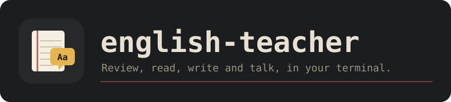

<p align="center">
  
</p>

<p align="center">
  A personal English teacher in the terminal: spaced review of your own words,<br>
  graded reading, writing with focused feedback, role-plays, fluency drills and quizzes.
</p>

<p align="center">
  <a href="LICENSE.md"></a>
  
  
  
</p>

<p align="center">
  <a href="#install">Install</a> · <a href="#quick-start">Quick start</a> · <a href="#the-screens">Screens</a> · <a href="#keys">Keys</a> · <a href="#the-ai-teacher">AI</a> · <a href="#why-it-works">Why it works</a> · <a href="#license">License</a>
</p>

```text
 Monday 9 Nov  ·  Home     Home  Review  Learn  Write  Talk  Fluency  Quiz  Listen  Pairs  Speak  Words  Stats
      │
      │   Good evening.
      │
      │   ▸ Review 5 words          ~3 min      enter
      │
      │   Words   ● 3 due   ◐ 1 learning   ✓ 1 known   ○ 2 new
      │
      │   Streak  0 days — review today to start one
      │   Today   0 of 20 min  ▱▱▱▱▱▱▱▱▱▱
      │   Week    Tu ○  We ○  Th ○  Fr ○  Sa ○  Su ○  Mo ○
      │
 A1  ·  5 due                                   enter start · tab screens · : palette · ? help · q quit
```

<sub>Home with sample data. Every screen is a notebook page, in light or dark terminals.</sub>

## What it answers

| | Question | Where you see it |
|:-:|:--|:--|
| 🔁 | **Which words do I need to review today?** | **Review**: spaced repetition (SM-2), recognize then produce |
| 📖 | **Can I read something at my level?** | **Learn**: a short text with at most 3 new words |
| ✍️ | **What am I getting wrong when I write?** | **Write**: fix your own errors, then rewrite them from memory |
| 💬 | **Can I hold a simple conversation?** | **Talk**: guided role-plays with gentle recasts |
| ⏱️ | **Can I say it faster?** | **Fluency**: the same story in 4, 3 and 2 minutes |
| ✅ | **What do I really remember?** | **Quiz**: vocabulary from your cards, grammar on your errors |
| 🎧 | **Do I understand it when I hear it?** | **Listen**: dictation of your own example sentences (needs audio) |
| 👂 | **Can I hear ship from sheep?** | **Pairs**: minimal pairs for Spanish speakers, weakest sounds first (needs audio) |
| 🗣️ | **Do people understand what I say?** | **Speak**: say your own sentences; whisper marks each word it understood (needs audio and whisper) |
| 🔥 | **Am I keeping it up?** | **Home** and **Stats**: streak, daily goal and study log |

## Install

```bash
brew install kevnnard/tap/english-teacher
```

<details>
<summary>Build from source</summary>

```bash
go install github.com/kevnnard/english-teacher/cmd/teacher@latest
```

The binary lands in `~/go/bin`; add `export PATH="$HOME/go/bin:$PATH"` to your
shell profile if `teacher` is not found. Building needs Go 1.27; no cgo.
</details>

Review, Fluency and the vocabulary quiz work offline. Learn, Write, Talk and
the grammar quiz need [the AI teacher](#the-ai-teacher).

## Quick start

```bash
teacher set name Ana         # Home greets you by name
teacher set goal 20          # daily goal in minutes (default 20)
teacher import ./progress    # optional: bring in an existing vocabulary bank
teacher                      # open the app on Home
```

`tab` moves between screens, `?` shows the keys of the current one, and Home
always preselects the next thing to do: press `enter`.

## Commands

```text
teacher [--db path] [--new n]                    open the app on Home
teacher [--db path] [--new n] review             open the app on Review
teacher [--db path] import <vocabulary-bank.md>  import a vocabulary bank
teacher [--db path] import <progress-folder>     import the bank, level.md and history
teacher [--db path] set name <name>              set your name
teacher [--db path] set goal <minutes>           set the daily goal (default 20)
teacher models                                   list the AI model of each capability
teacher set model <capability> <provider/model>  reading, writing, conversation or quiz
teacher setup voice                              download the default voice for speech
teacher setup whisper                            download the whisper model for Speak
teacher doctor                                   check the AI, speech and listening programs
teacher --version                                print the version
```

`--new n` caps the never-reviewed words per session (default 20). Importing is
optional and safe to repeat: a vocabulary bank is a markdown file of words and
meanings, and a progress folder adds `level.md`, `streak.md` and
`daily-log.md` when present. Re-importing never duplicates cards or days,
never resets a review schedule, and keeps the name and goal you set.

## The screens

**Home** (one preselected next action), **Review** (cards due today),
**Learn** (a short reading written for you), **Write** (a writing task you
correct with the AI), **Talk** (a guided role-play with the AI), **Fluency** (the same story
three times, faster each time), **Quiz** (vocabulary from your cards or
grammar from the AI), **Listen** (dictation of your own sentences, with
audio), **Pairs** (minimal pairs like ship / sheep, with audio), **Speak**
(say a sentence and see which words whisper understood, with audio and
whisper), **Words** (every word with its status) and **Stats**. Every screen is a notebook page: the top bar shows the date,
the page ("Page 3 of 26" during a review) and the screen tabs (on 80
columns the page name, which the active tab already shows, and then the
date make room for them, down to the weekday); a margin line
runs down the left (6 columns in from the edge on terminals 100+ columns
wide, 2 on narrower ones) and the text never gets wider than 76 columns.

The bottom row is the status bar: your level, cards still due, this
session's ✓/✗ and your streak on the left, the keys for the current screen on
the right.

Home shows today's study time against your daily goal and the last seven days
(`●` studied, `○` not). Stats adds your current and longest streak and a row per
day with minutes, cards and ✓/✗. A day counts for the streak when you grade at
least one card or finish an activity; time alone does not. The streak survives
until the end of the day after your last study day. Study time is the time
between grades, at most 2 minutes per card, so leaving the app open does not
count.
Word status is always a glyph plus a word: `● due`, `◐ learning`, `✓ known`, `○ new`.

### Review

Every word is studied in two directions, each with its own SM-2 schedule
and ✓/✗ counters:

- **Recognize** (English → Spanish): see the word, `space` to reveal the
  meaning, then grade yourself 1–4.
- **Produce** (Spanish → English): read the meaning and type the English.
  It starts only once you have recognized the word **twice in a row**
  (recognition repetitions ≥ 2): recognizing comes before producing.

A typed answer is compared ignoring case, surrounding spaces and trailing
punctuation:

| Answer | Shown | Grades allowed |
|---|---|---|
| exact | ✓, graded *good* automatically | `4` upgrades to *easy*, `enter` next |
| 1–2 letters off | ✗ almost, with a letter diff: `nice to me[a→e]t you` | `1` again · `2` hard |
| anything else | ✗ and the right answer | `1` again |

The grades map to SM-2 as again 1 · hard 3 · good 4 · easy 5, so "hard"
still passes and "again" brings the card back tomorrow. Answers are saved as
soon as you grade them; `u` takes the last grade back (in the database too)
until you grade the next card. In a typing prompt every key is a letter, so
`u` there types a "u".

A session is every card due today plus at most 20 new words (`--new`). It
ends with a summary page: how many you reviewed and how long it took, up to
three words to watch, and when the next review is. `r` replays the session's
mistakes for practice without moving any review date. The margin notes at the
foot of each card show your history with it: times seen, ✓/✗, when it comes
back if you grade it good, and the last wrong answer you typed.

### The AI teacher

Learn, Write, Talk and the grammar quiz use the AI through `pi`, the engine of Gentle Shell, so they
need Gentle Shell installed and signed in; the app never reads its
credentials. Each answer takes about 10 seconds. Without `pi` these screens
say how to turn it on and the rest of the app works as before.

- **Learn** writes a 60–100 word text at your level that reuses the words you
  know and adds at most 3 new words or chunks (`new` in the glossary), so you
  know about 98% of the text and learn the rest from context. New words come
  marked; `space` marks any other, `a` adds them as cards and records the
  reading as study (at most 15 minutes).
- **Write** runs six steps, built on research on written corrective
  feedback (focused, direct feedback on a few errors, then revision):
  1. **Plan** — a short task with a hint in Spanish and 2–4 useful phrases,
     taken from your own cards when they fit. When an error kind keeps coming
     back (seen twice or more), the task makes you practice the two most
     repeated ones.
  2. **Write** — `enter` is a new line, `ctrl+d` sends, `esc` keeps the draft.
  3. **Fix it yourself** — your text comes back with at most 3 major errors
     marked (`«I has 30 years»`) and the kind of each, but not the answer.
     You get one try per error; `enter` with nothing typed means "I don't
     know". A try equal to the teacher's fix counts right away; the others
     go to the teacher in one call, which also accepts valid alternatives.
     If that call fails, those tries count as not fixed and the page says so.
  4. **Feedback** — each major error shows `✓ fixed by you` or
     `✗ I has 30 years → I am 30 years old` with a one-line why in Spanish.
     Minor details are collapsed (`+2 minor details`); `d` shows them. Only
     the major errors you could not fix become cards (your version is kept as
     the last wrong answer), and every major error is logged by kind.
  5. **Rewrite** — for each error you could not fix you see its Spanish
     meaning and type the English from memory, checked like a typed review
     answer (✓, ✗ almost with the letter diff, or ✗ with the right answer).
     No AI call.
  6. **Result** — Grammar, Vocabulary, Coherence and Task, each out of 10,
     the total out of 40 with a grade (A ≥ 90%, B ≥ 80%, C ≥ 70%, D ≥ 60%,
     F below), the cards added and a pattern line when an error kind has been
     seen before (`Pattern: 3rd time with to be (am/is/are)`).

  The writing counts as study (`Writing: 32/40`, at most 30 minutes) as soon
  as the correction arrives. `n` starts a new task from the feedback or the
  result; `esc` goes Home and keeps your place.
- **Talk** is a guided role-play: *Introduce yourself*, *Order a coffee*,
  *Ask for directions* or *Small talk at work*. The tutor plays the other
  person (a classmate, a barista, a local, a coworker) and opens the
  conversation; you see the goal and sentence frames that fade with your
  level: A1 gets whole frames (`Can I have a ___, please?`), A2 only their
  first words (`Can I…`), B1 and above only the goal. Every key is a letter
  while you type; `enter` sends your line. The tutor answers in character,
  short and at your level, and when your line has an error it says it
  correctly inside its reply without stopping you; the correct version shows
  quietly under your line (`↳ Can I have a big coffee, please?`). If an
  answer fails, your line comes back and `enter` sends it again. The
  role-play ends when you meet the goal, after 8 of your lines or with
  `ctrl+d`. Then the teacher gives 2–3 short points in Spanish on what went
  well and what to work on, and lists your errors: the major ones become
  cards (your line is the example), and are logged by kind like Write's.
  The role-play counts as study (`Talk: Order a coffee`, at most 20 minutes)
  when the feedback arrives; leaving before that records nothing. `n` picks
  a new role-play; `esc` goes Home and keeps the conversation.

  **By voice** (with [audio](#audio-optional)): `ctrl+r` records your line
  (`ctrl+r` again stops, `esc` cancels) and whisper writes what it heard
  into the input, after anything you typed. It is never sent by itself:
  read it, fix what whisper got wrong and press `enter`. The tutor's
  opening and replies are read aloud as they arrive; `ctrl+t` turns this
  voice mode off (or on again) until you quit, and `ctrl+p` says the last
  reply again (twice quickly: slower). The `↳` correction is only shown,
  never read aloud. The voice keys are ctrl keys because every letter types.

### Fluency

Fluency is the written 4/3/2 exercise: tell the same story three times, in
4, 3 and 2 minutes, so the words you already know come out faster. It uses
no AI, so it works without `pi`. Pick a topic (*Your morning routine*,
*Your best friend*, *Your last weekend*, *Your home*, *Your favorite food*)
or the last entry to type your own. Each round starts on `enter`; the
clock counts down on the page and every key is a letter while it runs
(`enter` is a new line). When the time is up the round ends and the text
locks; `ctrl+d` ends it early. Words per minute is the words of the text
(split on spaces) divided by the minutes used, at most the round's limit.
The result shows one line per round (`Round 1 · 4:00 · 38 words · 9.5 wpm`)
and the change from round 1 to round 3. The session counts as study
(`Fluency: Your home`, the real time since round 1 began, at most 9
minutes) when round 3 ends; leaving earlier records nothing. `esc` goes
Home and the clock keeps running, so a round can end while you are
elsewhere; `n` picks a new topic between rounds or from the result.

### Quiz

Quiz checks what you remember. It is retrieval practice, not grading: a
quiz never changes your review dates. Pick one of two:

- **Vocabulary** uses no AI, so it works without `pi`. It asks 10 words of
  your own deck (each word once, in a new order every time), alternating
  multiple choice (the Spanish meaning → choose the English word among 4,
  with other words of your deck as the wrong options; keys `1`–`4`) and
  typed (the meaning, and the example with the word blanked → type the
  word, checked like a typed review answer: ✓, ✗ almost with the letter
  diff, or ✗ with the right answer). With fewer than 4 words every
  question is typed; with fewer than 10 there is one question per word; an
  empty deck says so.
- **Grammar** asks the teacher for 8 multiple-choice items at your level on
  your current lesson: the two error kinds you repeat most (seen twice or
  more, as in Write), or else the core grammar of your level (A1: to be,
  present simple, articles, plurals, possessives). Items with a bad answer
  or the wrong number of options are dropped; fewer than 3 good ones is an
  error. If the call fails, the page says why and `enter` tries again.

After each answer you see ✓, or ✗ with the right answer and, for grammar,
why in Spanish; `enter` moves on, and every key is a letter while you type
an answer. The result shows your score (`8/10`) and the questions to look at
again (a grammar item with its why). The quiz counts as study
(`Quiz: vocabulary 8/10` or `Quiz: grammar 6/8`, at most 10 minutes) when
you answer the last question; leaving earlier records nothing. `n` starts a
new quiz; `esc` goes Home and keeps the quiz.

### Listen

Listen is dictation, and needs [audio](#audio-optional). It plays up to 10
example sentences of your own cards (each once, at most 12 words long; words
you have studied in Review first), one by one; you type what you hear.
Each sentence plays when it appears; `ctrl+p` plays it again and `ctrl+s`
slower (`p` and `s` are letters while you type). `enter` checks it like a
typed review answer: case and punctuation never count, so ✓ correct; a
typo of 1 or 2 letters is ✓ almost with the letter diff and still counts;
anything else is ✗ with the sentence and the words you missed. An empty
`enter` means "I don't know" and shows the sentence. The result shows your
score (`7/10`) and the sentences to practice. It counts as study
(`Listen: 7/10`, at most 10 minutes) when you answer the last sentence;
it never changes your review dates. With fewer than 3 sentences, or
without audio, the page says how to get them.

### Pairs

Pairs trains your ear on the English sounds that are one sound in Spanish,
and needs [audio](#audio-optional). A round plays 20 words, one by one;
each comes from a pair of real words that differ in one sound, shown as
`1 ship   2 sheep`, and you press `1` or `2` for the one you heard. Each
word plays when it appears; `p` plays it again and `s` slower. Then you see
✓, or ✗ "You heard: sheep" with a tip in Spanish on how to make the
difference; `1` and `2` now play each word so you can compare, and `enter`
goes on. The contrasts:

| Contrast | Pairs |
|---|---|
| i corta / i larga | ship / sheep, live / leave, sit / seat, fill / feel |
| u corta / u larga | full / fool, pull / pool, look / Luke |
| a de cat / a de cut | cat / cut, hat / hut, bag / bug, cap / cup |
| b / v | bat / vat, berry / very, ban / van, best / vest |
| th / s | think / sink, thick / sick, path / pass, mouth / mouse |
| th suave / d | they / day, then / den, though / dough |
| verbo / verbo + -ed | work / worked, walk / walked, play / played, open / opened |
| s + consonante / e + s | state / estate, steam / esteem, special / especial |

Your results per contrast are kept, and the next round starts with your
weakest: each contrast gets items by weight `1 + 9 × (wrong + 1) / (heard + 2)`
(an unseen one counts as half wrong), the three weakest always get at least
one, and the words go round robin, weakest first. With two or more voices
in the voices folder, the words take turns between them, which trains the
ear better than one voice; add one with the files of, for example,
[en_US-amy-medium](https://huggingface.co/rhasspy/piper-voices/tree/main/en/en_US/amy/medium)
(the `.onnx` and `.onnx.json`). The result shows your score (`17/20`), each
contrast of the round and the weakest one with its tip. A round counts as
study (`Pairs: 17/20`, at most 10 minutes) and saves your results when you
answer the last word; a round left midway saves nothing.

### Speak

Speak is shadowing: hear a sentence, then say it. It needs
[audio and whisper](#audio-optional). A round takes up to 8 example
sentences of your own cards (the same ones as Listen: at most 12 words,
studied words first). Each sentence is on the page and plays when it
appears; `p` plays it again and `s` slower. `enter` starts recording
("● Recording… enter to stop"), `enter` again stops it, and whisper writes
down what it heard, on your computer ("Listening…"); `esc` while recording
throws the recording away. Then every word of the sentence is marked:
green when whisper understood it, amber and underlined when not, with
"Whisper heard: …" below. Words are compared ignoring case and punctuation
(not the apostrophe); `30` equals `thirty`, and spellings that sound the
same match (`colour` and `color`, `Ana` and `Anna`). A changed vowel or a
dropped ending never does: `ship` is not `shop` or `sheep`, and `worked`
is not `work`. `r` tries the same sentence again;
`enter` goes on.

Words not understood are practice items for this round: after the last
sentence, every sentence that had a word not understood comes back once, as
"Practice again". The result shows how many sentences whisper fully
understood at the first try (`6 of 8 sentences fully understood`) and the
words to practise. The round counts as study (`Speak: 6/8`, at most 10
minutes) when it ends. The words to practise are not stored: only the
activity is. Without audio or whisper, the page says how to set them up.

## Configuration and data

Models live in `$XDG_CONFIG_HOME/english-teacher/config.json`
(`~/.config/english-teacher/config.json`); `--config path` picks another.
The defaults are Sonnet for reading, writing and conversation and Haiku for
quizzes; any model in `pi --list-models` works. A `"pi"` key sets the path of
the `pi` binary; `"piper"` sets the path of `piper` and `"voice"` a voice
model path or name (looked up in the voices folder).

## Audio (optional)

The app can read words and texts aloud with [Piper](https://github.com/OHF-Voice/piper1-gpl),
a local text-to-speech program. Everything runs on your machine; without it
the app works the same, just silent.

```sh
uv tool install piper-tts   # installs ~/.local/bin/piper
teacher setup voice         # downloads en_US-lessac-medium (about 60 MB)
teacher doctor              # shows what is found: pi, piper, the voice, a player, whisper, a recorder
```

Speak and Talk also listen to you, with [whisper.cpp](https://github.com/ggml-org/whisper.cpp),
a local speech-to-text program, and a recorder:

```sh
brew install whisper-cpp    # installs whisper-cli (or build it: see the whisper.cpp README)
teacher setup whisper       # downloads the model ggml-base.en (about 150 MB)
```

The model lives in `$XDG_DATA_HOME/english-teacher/models/`
(`~/.local/share/english-teacher/models/`). `whisper-cli` is looked up on
your PATH, then in Homebrew's folders (`/home/linuxbrew/.linuxbrew/bin`,
`~/.linuxbrew/bin`, `/opt/homebrew/bin`, `/usr/local/bin`). Your voice is
recorded with the first of `pw-record` (PipeWire), `arecord` (ALSA) or
`sox` found, at 16 kHz mono, into a temporary file that is removed once
whisper has read it. Nothing leaves your machine.

Voices live in `$XDG_DATA_HOME/english-teacher/voices/`
(`~/.local/share/english-teacher/voices/`). Sound plays through the first of
`pw-play`, `paplay`, `aplay` or `afplay` on your PATH.

Press `p` to listen; `p` twice within 2 seconds plays the same text slower.

| Screen | `p` says |
|---|---|
| Review | the English word; after `space`, the word and its example. A typed (Spanish → English) card only once checked, so it never gives the answer away |
| Learn | the selected glossary word; `P` reads the whole text |
| Write | the right version of the first error you did not fix (feedback), or of the one you just rewrote |
| Quiz | the right answer, once you have answered |
| Listen | the sentence, once checked (while typing: `ctrl+p`, `ctrl+s` slower) |
| Pairs | the word played (`s` slower); after the answer, `1` and `2` play each word |
| Speak | the sentence (`s` slower) |
| Talk | the tutor's lines, on their own in voice mode (`ctrl+t` on / off); `ctrl+p` the last one again. `ctrl+r` records your line into the input |

While you type, `p` is a letter. Without audio, `p` shows
"Audio is off: run `teacher doctor`" and nothing else changes.


<details>
<summary>Where your data lives</summary>

Everything stays on your machine, in SQLite:
`$XDG_DATA_HOME/english-teacher/teacher.db` (`~/.local/share/english-teacher/teacher.db`
if unset). `--db path` before the command picks another file, e.g.
`teacher --db /tmp/test.db review`. The schema migrates in place on start.
</details>

## Why it works

- **Four strands** (Nation): meaning-focused input (Learn), meaning-focused output (Write, Talk), language-focused learning (Review, Quiz) and fluency (Fluency), in roughly equal time.
- **Spaced repetition** (SM-2): each word comes back just before you would forget it, in both directions.
- **Graded reading**: at about 98% known words you learn the rest from context; Learn adds at most 3 new ones.
- **Focused written feedback**: a few major errors, direct and explained, work better than marking everything.
- **Self-correction, then rewriting**: trying first makes you notice the gap; rewriting from memory is what makes the fix stick.
- **Recasts**: in conversation the right form is woven into the reply, so you keep talking.
- **4/3/2**: retelling the same story with less time builds fluency with words you already know.

## Keys

The `?` overlay shows the keys that work everywhere plus those of the
current screen.

| Where | Key | Action |
|---|---|---|
| everywhere | `tab` / `shift+tab` | next / previous screen |
| | `:` | command palette: type a screen name, `enter` to go |
| | `?` | show / hide help |
| | `c` | show / hide the margin notes during review |
| | `esc` | back to Home |
| | `q` | quit on Home, back to Home elsewhere |
| | `ctrl+c` | quit |
| Home | `enter` | start the preselected action |
| Review | `space` | reveal the answer (English → Spanish) |
| | `1`–`4` | grade your recall: 1 again · 2 hard · 3 good · 4 easy |
| | `enter` | check a typed answer (Spanish → English) |
| | `u` / `ctrl+z` | undo the last grade (`ctrl+z` also works while typing an answer) |
| | `r` | review the session's mistakes again (dates don't move) |
| | `p` | listen to the word, and after `space` its example; a typed card only once checked |
| Learn | `enter` | get a short text written for you |
| | `↑` `↓` / `j` `k` | move through the glossary |
| | `space` | mark or unmark a word to study |
| | `a` | done: add the marked words as cards |
| | `n` | a new text |
| | `p` / `P` | listen to the selected glossary word / read the whole text |
| Write | `enter` | get a task; while writing, a new line |
| | `ctrl+d` | send your text to the teacher |
| | `enter` | fixing or rewriting: submit (empty: I don't know) |
| | `d` | show / hide the minor details in the feedback |
| | `s` | save the error cards again if saving failed |
| | `n` | a new task from the feedback or the result |
| | `p` | in the feedback and a checked rewrite: listen to the right version |
| | `esc` | back to Home; your work stays |
| Talk | `↑` `↓` / `j` `k` | choose a situation |
| | `enter` | start it; while talking, send your line (after a failed answer, the same line again) |
| | `ctrl+r` | say your line: `ctrl+r` again stops, `esc` cancels; what whisper heard goes into the input to edit and send |
| | `ctrl+p` | hear the last reply again (twice quickly: slower) |
| | `ctrl+t` | voice mode on / off: replies read aloud (on when audio is set up) |
| | `ctrl+d` | finish the role-play early and get feedback |
| | `s` | save the error cards again if saving failed |
| | `n` | a new role-play from the feedback |
| | `esc` | back to Home; the conversation stays |
| Fluency | `↑` `↓` / `j` `k` | choose a topic (the last one: type your own) |
| | `enter` | pick it; then start each round's clock |
| | `ctrl+d` | end the round early; the time stops |
| | `n` | a new topic between rounds or from the result |
| | `esc` | back to Home; the clock keeps running |
| Quiz | `↑` `↓` / `j` `k` | choose a vocabulary or a grammar quiz |
| | `enter` | start it; after the feedback, the next question |
| | `1`–`4` | choose an option |
| | `enter` | check a typed answer (empty: I don't know) |
| | `enter` | after a failed grammar quiz: try again |
| | `n` | a new quiz from the result |
| | `p` | after an answer: listen to the right answer |
| | `esc` | back to Home; the quiz stays |
| Listen | `enter` | start a dictation; after the feedback, the next sentence |
| | `ctrl+p` / `ctrl+s` | hear the sentence again / slower (`p` and `s` are letters here) |
| | `enter` | check what you typed (empty: I don't know) |
| | `n` | a new dictation from the result |
| | `esc` | back to Home; the dictation stays |
| Pairs | `enter` | start a round; after the feedback, the next word |
| | `1` / `2` | choose which word you heard; after it, hear each one |
| | `p` / `s` | hear the word again / slower |
| | `n` | a new round from the result |
| | `esc` | back to Home; the round stays (saved only at the end) |
| Speak | `enter` | start a round; start / stop recording; after the marks, the next sentence |
| | `p` / `s` | hear the sentence again / slower |
| | `esc` | while recording: cancel it; else back to Home (the round stays) |
| | `r` | after the marks: try the same sentence again |
| | `n` | a new round from the result |
| Words | `/` | filter by word or meaning (`enter` keep · `esc` clear) |
| | `↑` `↓` / `j` `k` | scroll |


## Project layout

```
cmd/teacher/        CLI entry point
internal/domain/    pure types: Card, Grade, Answer, Direction
internal/srs/       SM-2 scheduler and session planning (pure, no I/O)
internal/check/     typed-answer check, letter diff and spoken-word marks (pure)
internal/progress/  streak, week and daily totals (pure, no I/O)
internal/importer/  imports a markdown vocabulary bank and progress folder
internal/store/     SQLite persistence
internal/llm/pi/    runs the AI through the pi CLI
internal/speech/    audio port; speech/piper/ speaks through Piper, speech/whisper/ records and transcribes
internal/teacher/   AI teacher use cases: prompts and answers
internal/tui/       Bubbletea screens
```

## Roadmap

- **0.1.0** — every text feature: Review, Learn, Write, Talk, Fluency, Quiz, streak and daily log. See [CHANGELOG.md](CHANGELOG.md).
- **0.2.0** — voice, all local and optional: `p` to listen everywhere, Listen (dictation), Pairs (minimal pairs), Speak (shadowing with per-word feedback) and Talk by voice.
- **Next** — audio cache for instant replays, a microphone check in `teacher doctor`, retention chart on Home.

## Releasing

Releases are cut from `main` by one script: it runs the tests, tags and pushes,
creates the GitHub release and rewrites the Homebrew formula in the tap. The
version is injected at build time (`-X main.version`).

```bash
TAP_DIR=../homebrew-tap scripts/release.sh --dry-run 0.1.0   # show every step
TAP_DIR=../homebrew-tap scripts/release.sh 0.1.0
```

## License

**english-teacher is source-available, not open source.** You can read the code, build it and use it for personal, noncommercial purposes.

You may **not**:
- share or redistribute it, in source or binary form;
- publish modified versions or new works based on it;
- use it commercially.

The full terms are in [PolyForm Strict License 1.0.0](LICENSE.md).

Copyright © 2026 Kevnnard.
